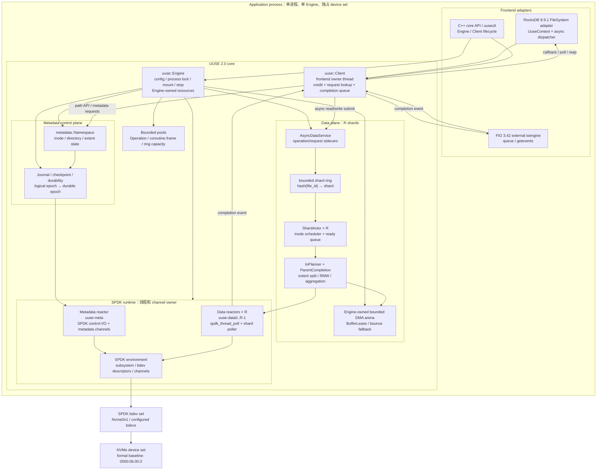
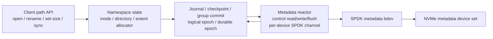
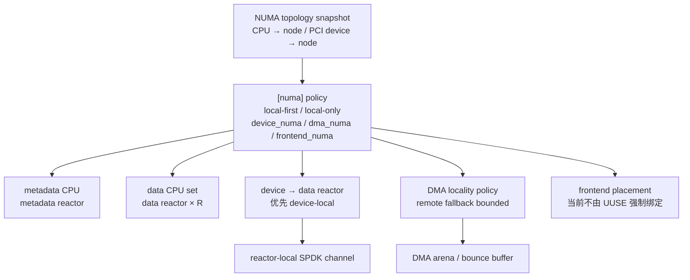

# UUSE 2.0 Architecture

> 更新时间：2026-09-21  
> 本文是 `doc/design/hfs2.0.md` 的架构图解，不替代其接口、边界和验收约束。  
> 当前正式验证口径：单 Application process、单 Engine、真实 NVMe/SPDK bdev；多 NUMA
> 虚拟机尚未配置完成，因此多 NUMA 只描述架构，不作为当前验证结论。

## 1. 结论：顶层边界基本正确，但需要补充实现边界

你给出的图仍然是正确的顶层模型：UUSE 2.0 没有 `uused`，RocksDB/FIO 与 UUSE core
运行在同一个 Application process 内，core 直接管理 SPDK bdev，SPDK 再连接 NVMe
device set。

需要补充四点：

1. `uuse::Engine` 是进程级生命周期和资源 owner；`uuse::Client` 是 frontend 的异步
   completion sink 和路径 API facade，不是另一个独立进程。
2. `data shard actor × R` 是当前已经落地的实际数据路径：每个 shard 有 bounded ring、
   `ShardActor`、inode scheduler 和 backend，由对应 data reactor 的 poller 驱动。
3. “metadata actor coroutine”目前应理解为 metadata control plane 的目标模型。当前实现
   已有独立 metadata reactor 和 metadata device control I/O channel，但 namespace 的部分
   API 操作仍由 `Client` task 直接调用 `metadata::Namespace`；不能把它描述成已经完全
   隔离的 metadata actor 线程。
4. NUMA topology 已能读取并用于 data reactor/device-local placement；`dma_numa`、
   `frontend_numa` 的完整本地化和跨 NUMA 性能验证仍未完成。

## 2. 当前架构总图



## 3. 两条主要 I/O 路径

### 3.1 数据 I/O：RocksDB/FIO 到 NVMe

```mermaid
flowchart LR
    FRONT["RocksDB dispatcher / FIO frontend"]
    CLIENT["uuse::Client\nsubmitRead / submitWrite"]
    ACCEPT["预检并接受\ncredit + Operation + sidecar + IoHandle"]
    RING["bounded MPSC shard ring\nhash(file_id) 固定 shard"]
    ACTOR["data reactor 上的 ShardActor\nrunOnce / retry / ready drain"]
    SCHED["inode dependency scheduler\n同一 inode 保序"]
    PLAN["IoPlanner\nextent lookup / split / RMW"]
    LEASE["BufferLease\ncaller DMA 或 arena bounce"]
    BACKEND["actor-local async backend\nSPDK channel submit"]
    NVME["SPDK bdev → NVMe"]
    COMPLETE["SPDK callback\nactor completion queue"]
    PARENT["ParentCompletion\ncompleted bytes + first error"]
    CQ["Client completion queue\nslot + generation + request_id"]

    FRONT --> CLIENT --> ACCEPT --> RING --> ACTOR --> SCHED --> PLAN --> LEASE --> BACKEND --> NVME
    NVME --> COMPLETE --> PARENT --> CQ --> FRONT
```



关键约束：

- frontend 不直接调用 `spdk_thread_poll`、bdev submit 或持有 SPDK channel；
- data backend 只由对应 shard actor 调用；SPDK callback 只记录结果并排入 actor ready
  queue，后续由 actor 完成 parent 聚合；
- `completionWake` 只是低延迟唤醒提示，completion queue 才是完成事实源；
- 接受请求后，`Operation`、extent snapshot、DMA lease、completion sink 和 frontend
  handle 必须保持到 terminal completion；
- 同一个 `uuse::Client` 的 async facade 只允许一个 frontend owner thread。

### 3.2 Metadata / durability 路径



当前实现需要特别区分：metadata reactor 已经真实存在，负责 SPDK env、bdev descriptor、
metadata channel 以及控制路径 device I/O；但 `metadata::Namespace` 的部分内存状态变更
目前仍从 `Client` task 直接进入。未来如果要把 metadata actor 变成严格的单 owner coroutine
actor，需要把 namespace mutation、journal intent 和 durability request 统一收敛到该 actor
的 ingress queue，不能只依靠调用方约定。

## 4. 线程、所有权和资源关系

| 组件 | 当前 owner | 主要职责 | 跨线程规则 |
|---|---|---|---|
| `uuse::Engine` | 进程级 engine owner | 配置、process lock、mount/stop、设备集、资源生命周期 | Engine 必须先 drain client 和 reactor，再 stop |
| `uuse::Client` | 一个 frontend owner thread | path API、async slot、request lookup、completion queue | async `submit/poll/close` 不允许多线程共享 |
| RocksDB dispatcher | RocksDB adapter 内部 frontend thread | worker 请求排队、submit/poll/reap、回调转交 | worker 不直接接触 core async owner |
| metadata reactor | `uuse-meta` SPDK thread | SPDK env 初始化、metadata channel、control I/O、设备关闭 | 只能在所属 SPDK thread 使用 channel |
| data reactor | `uuse-data0..R-1` | SPDK poll、`AsyncDataService::pump(shard)`、data channel | 一个 shard 绑定一个 actor/backend/reactor |
| `AsyncDataService` | Engine | operation sidecar、bounded shard ring、scheduler、parent completion | accepted operation 以 bounded pool 保活 |
| `DmaArena` | Engine | 有界 DMA/bounce buffer、BufferLease | 由 data path acquire/release，不能无限扩容 |
| SPDK bdev descriptor/channel | runtime reactor | raw bdev submit/completion | 不暴露给 frontend 或 public C++ API |

## 5. CPU / NUMA 视图



当前状态：

- `SpdkRuntime` 会读取 topology，并按 device NUMA node 优先选择 data reactor；无法解析时
  使用确定性 fallback；
- `config/uuse_nvme.conf` 当前是单 NUMA baseline：`metadata_cpus=0`、
  `data_reactors=1`、`data_cpus=1`、`frontend_cpus=3`、`polling=hybrid`；
- `dma_numa`、`frontend_numa` 已进入配置 schema，但完整的 DMA node 选择、frontend
  绑核和远端 DMA 性能闭环还没有在多 NUMA VM 上验证；
- 多 NUMA 机器上的目标关系是：metadata/data reactor 尽量靠近其负责的 device，DMA
  buffer 与 device node 对齐，remote DMA 只作为有界 fallback，不能静默扩散；
- 因此，当前不能把“多 NUMA 本地 DMA 性能已达标”写成已实现能力。

## 6. 进程和设备边界

```text
允许：
  一个 Application process
    └── 一个 UUSE Engine
          └── 独占 .conf 声明的完整 SPDK bdev/device set

不允许：
  多个进程同时挂载同一 bdev
  uused/daemon + IPC + shared-memory mount
  POSIX preload / fd wrapper / FUSE / 通用 mmap
  frontend 直接绕过 UUSE core 操作 NVMe
```

这也是为什么顶层图的最外层仍然是 `Application process`，而不是一个 UUSE 服务进程：
UUSE 2.0 采用 clean-break 的进程内 ownership 模型，RocksDB/FIO 适配器、UUSE core、SPDK
runtime 和 bdev channel 在同一进程内协作；进程退出或 fork 后，core 不提供跨进程继续使用
同一 engine 的兼容语义。

## 7. 与当前代码的对应关系

| 架构概念 | 主要实现位置 |
|---|---|
| Engine / Client facade | `include/uuse/core.hpp`, `src/core/engine.cpp`, `src/core/client.cpp` |
| SPDK env、metadata/data reactor | `src/runtime/spdk_runtime.cpp` |
| NUMA topology | `src/runtime/numa_topology.cpp` |
| bounded data shard actor | `src/core/async_data_service.cpp`, `src/core/actor.cpp`, `src/core/shard_ring.cpp` |
| planner / scheduler / parent completion | `src/core/io_planner.cpp`, `src/core/scheduler.cpp`, `src/core/parent_completion.cpp` |
| DMA arena | `src/core/dma_arena.cpp` |
| metadata namespace / journal | `src/metadata/namespace.cpp`, `src/storage/journal.cpp` |
| RocksDB frontend | `rocksdb/uuse_filesystem.cpp` |
| FIO frontend | `fio/fio_uuse.cpp`, `fio/fio_completion_hub.cpp` |

