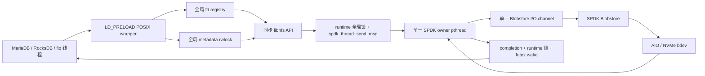
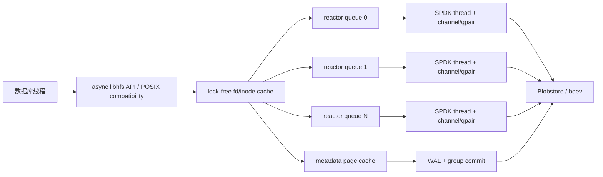

# HFS（SPDK Blobstore）架构与性能审查

**审查日期**：2026-09-05  
**源码基线**：本地 `main@431735e`（shard-35 收口）  
**审查范围**：HFS 运行时、数据 I/O、元数据与恢复、fd/POSIX 拦截层、MariaDB/RocksDB 支持路径、现有 FIO/数据库基线  
**方法**：源码静态审查 + 既有基线交叉核对 + VM 定向探针  

> 说明：VM `/root/code/HFS_BASE_SPDK` 是同步后的构建目录，不含 `.git` 元数据。因此本文以本地
> `main@431735e` 作为源码版本基线；VM 探针用于验证部署构建的行为和性能趋势，不把 VM 目录
> 单独当作 Git 提交身份的证明。

## 1. 结论摘要

当前 HFS 已经是一个**功能边界清楚、可运行真实 MariaDB/RocksDB 的单进程兼容性原型**：
请求级 I/O、固定 DMA pool、非对齐 RMW、fd 生命周期、元数据 intent 恢复和数据库持久化
smoke 都有扎实基础。但从存储架构和性能角度，它还不是可横向扩展的通用文件系统，也没有
真正释放 SPDK 的多队列、异步和轮询模型优势。

最关键的判断如下：

1. **首要风险不是继续微调 memcpy，而是先修复持久化与失败语义。** 已复现 truncate
   缩短后再扩展会读回旧数据；源码还存在 SPDK callback 错误不传播、元数据提交失败不回滚、
   fsync 最后一次设备 flush 发生在 inode 元数据事务之前等问题。它们会使“返回成功”和
   “真正持久化”之间失去可信关系。
2. **当前数据面被同步桥和全局共享状态限制。** 每个 POSIX I/O 都经应用线程提交消息给一个
   SPDK owner pthread，再由 futex 唤醒调用线程；全文件系统只使用一个 blobstore channel。
   这让线程数代替了 queue depth，并把多队列 NVMe 压缩成单提交点。
3. **高频全局锁是当前并发扩展的直接阻力。** fd 分类、fd 引用计数、runtime submit/complete、
   文件大小读取、每次写后的 metadata 检查都触碰全局锁。VM 同口径 4K randrw 从 1 线程
   12.80K IOPS 增加到 4 线程仅 22.62K IOPS，即 1.77 倍。
4. **元数据算法在文件数增长后会成为压倒性瓶颈。** inode 是 65,536 项平面数组，name/id
   lookup 都是 O(N)；一次 inode 变更要读一遍完整 metadata blob，再把 pending、committed、
   cleared 三个完整镜像各写一遍。默认 1MiB cluster 下，即使 inode 很少，一次变更也至少
   产生约 4MiB metadata blob I/O；接近 inode 上限时约为 56MiB。
5. **现有 FIO 的 HFS/SPDK 对比不能用于精确归因。** HFS 使用 `psync`，实际 QD 约为 1；裸
   SPDK 使用异步 engine、QD=32。HFS 只有裸 SPDK 25.9%～29.6% 的结果包含了同步/异步模型
   差异，不等于纯文件系统层开销。
6. **产品架构需要做一次明确选择。** 若目标是“单数据库进程加速器”，应把显式异步 libhfs
   和数据库适配器作为主路径，LD_PRELOAD 只保留兼容模式；若目标是“多进程通用文件系统”，
   应让一个 HFS 服务进程独占 SPDK/Blobstore，通过共享内存队列或 fsdev/FUSE/ublk 服务客户端，
   而不是继续扩展每进程 LD_PRELOAD + backend flock。

综合评价：**功能成熟度高于性能架构成熟度；近期应先完成 P0 正确性修复，再重构并发模型，
最后做元数据页化/日志化。** 直接在当前全局锁和整表事务上增加更多 wrapper，收益会迅速递减。

## 2. 当前架构画像

这个设计解决了一个重要正确性问题：所有 SPDK/Blobstore 操作都回到 owner thread，避免业务
线程直接 poll 或跨线程错误使用 channel。但代价也很明确：

- 每个同步调用至少包含一次跨线程消息和一次睡眠/唤醒；
- 所有设备提交共享一个 owner、一个 channel，无法利用多 queue pair；
- runtime submit 与 completion 还争用同一全局 mutex；
- POSIX API 没有表达真正的异步 queue depth，只能靠增加应用线程堆叠请求；
- SPDK owner 在 `spdk_thread_poll()` 上持续 busy poll，但没有明确的 CPU pinning、NUMA 绑定
  和空闲/中断策略。

这是一种“把异步 SPDK 包装成同步文件 API”的可行原型结构，但不是高性能终态。

## 3. 已验证的性能与行为证据

### 3.1 现有基线

- 4K randrw：HFS 约 12.97K 总 IOPS，裸 SPDK bdev 约 50.02K，总比值 25.9%；64K 比值
  约 29.6%。但前者是 `psync/QD≈1`，后者是异步 `QD=32`，不能把全部差距归因于 HFS。
- MariaDB 读负载：HFS/原生约 87.2%～100.4%；autocommit 写负载只有 33.7%～53.4%。
  这与当前每次 durable write 进入全局 I/O barrier、设备 flush 和整表元数据事务的实现吻合。
- RocksDB readwhilewriting 从 1 线程 63,854 ops/s 扩展到 4 线程 235,831 ops/s（3.69 倍），
  但这是完整数据库 workload，CPU 从 222% 增至 518%，不能单独证明 HFS 数据面接近线性。

### 3.2 本次同 HFS 并发探针

工作负载为 Malloc bdev、4K randrw、`psync`、线程模式；计数包含 fio 准备阶段和稳态阶段，
两组都开启相同的 HFS 统计，因此适合比较趋势。

| fio 线程 | 总 IOPS | 相对 1 线程 | fd 读锁 | fd 写锁 | meta 读锁 | meta 写锁 | DMA peak | SPDK submit/complete |
|---:|---:|---:|---:|---:|---:|---:|---:|---:|
| 1 | 12,796.72 | 1.00× | 151,948 | 288,751 | 64,163 | 80,229 | 1 | 144,471 / 144,471 |
| 4 | 22,620.64 | 1.77× | 250,221 | 485,279 | 112,857 | 129,826 | 4 | 242,732 / 242,732 |

结论：DMA pool 在这组负载中没有耗尽，SPDK 也没有 reject；扩展性损失主要发生在进入设备前
的 fd/meta/runtime 共享状态和同步提交模型。4 线程只达到 1.77 倍，说明继续单纯增大 DMA pool
或提高 fio `iodepth` 不会解决主问题。

### 3.3 本次正确性探针

| 探针 | 期望 | 实际 |
|---|---|---|
| 写 4096 个 `A` → truncate 到 0 → 扩展到 4096 → read | 4096 个零 | 仍读到 4096 个 `A` |
| 把 mtime 设为 1s → offset 0 覆盖写 → fsync → fstat | mtime 前进 | mtime 仍为 1s |
| 默认 1.5GiB Malloc0 上 `statvfs` | 接近后端有效容量 | 报告 783,360 bytes |

这些问题已登记到 `doc/bug.md` 的 45～50 条。

## 4. 设计缺陷与性能阻塞点

### 4.1 P0：truncate 的逻辑 EOF 与有效数据范围没有分离

`hfs_lib_ftruncate` 缩短文件时只修改 inode size，不缩小 blob、不打孔、不清零新 EOF 后的
payload（`src/hfs_lib.c:1441`）。再次扩展时，`hfsResizeTo` 发现已有 cluster 足够便直接返回，
历史内容重新变为可见数据。

影响：

- 违反文件扩展区域必须读零的基本契约；
- 可能泄露事务回滚、临时表或已删除记录的历史内容；
- truncate 不回收空间，长期运行会产生隐性空间占用；
- 现有 sparse/punch 测试没有覆盖 shrink→grow 和 O_TRUNC→grow。

优化方向：用 `logicalSize`、`allocatedHighWatermark`、稀疏 extent/zero extent 分别描述逻辑
长度与物理有效性。shrink 时清零非对齐尾 unit，并释放或标记后续完整 cluster；grow 时确保
旧 EOF 到新 EOF 是逻辑零，不能只依赖 blob 当前 cluster 数。

### 4.2 P0：异步 callback 的失败结果没有统一传播

数据 I/O 的 `HfsIoRequest` 已经保存 `operationRc`，但元数据和部分 blob 生命周期仍沿用
“completion 只表示回调到达”的旧模型：

- `hfsMetaOpCb` 忽略 `bserrno`（`src/hfs_meta.c:214`）；
- `hfsMetaBlobWrite` 只要 open/resize/write/sync/close 的 callback 都到达，就可返回 0
  （`src/hfs_meta.c:278`）；
- open-by-id、close、delete callback 记录错误日志但不让 public API 失败
  （`src/hfs_file.c:15`、`:27`、`:237`）。

影响：设备 I/O 错误、ENOSPC、blob metadata 错误可能向数据库返回成功；这比普通性能回退
严重，因为上层 WAL/事务会基于错误的成功信号推进 durable state。

优化方向：所有 SPDK 操作统一使用 request-local context：`state + rc + callback ownership`。
callback 必须先写 rc，再发布 completion；public API 统一做负 errno 转换。用 error bdev 对
open、resize、read/write、sync、close、delete、unload 的每个边界注入失败。

### 4.3 P0：fsync 的最后持久化 barrier 顺序不完整

当前 `hfs_lib_fsync` 先调用 `hfsSync`：blob metadata sync → bdev flush；随后才执行
`hfsMetaCommitInode`（`src/hfs_lib.c:1958`）。inode transaction 又向 metadata blob 写入
intent、stable image、clear intent，但事务完成后没有新的 bdev flush。

本仓库 SPDK bdev API 明确说明：带 volatile cache 的设备在 flush 完成之前不保证数据持久化
（`spdk/include/spdk/bdev.h:1967`）。当前 `_exit`/SIGKILL smoke 只能证明进程崩溃恢复，不能
证明 NVMe 写缓存掉电恢复。

影响：fsync 返回后，payload 可能已持久，但 inode size/mtime 或命名空间事务仍只在易失缓存；
重启后可能出现“数据存在、长度回退”或 intent/stable 顺序不满足恢复假设。

优化方向：明确 power-fail 模型并建立持久化 epoch：

1. 等待该文件数据 I/O 和新增 extent/blob mapping 完成；
2. flush 数据和 blob mapping；
3. 写 metadata WAL/intent 并 flush；
4. 写 commit/stable page 并 flush；
5. clear/回收记录可延迟批量完成。

多个并发 fsync 应进入 group commit，同一个设备 epoch 共享 flush，而不是每个 fd 独立发全设备
flush。

### 4.4 P0：内存元数据不是可失败的事务

mkdir/create/remove/rename/set-size 都先原地修改 `fs->inodes` 和 `inodeCount`，再调用
`hfsMetaCommit`。一旦 commit 失败，函数释放临时 buffer 后直接返回，内存表没有 undo；
create-file 已经创建的数据 blob 也没有完整补偿清理（`src/hfs_meta.c:928`、`:1036`、`:1094`、
`:1132`、`:1220`）。

影响：调用方收到失败后，同一进程仍可能看到未落盘的新文件/新名字/新 size；重启后又回到
旧状态。错误处理期间还会遗留 orphan blob 或 placeholder fd。

优化方向：在私有 transaction 对象内构造 after-image，磁盘提交成功后再 publish 到读者；
或者保留完整 undo image，在任一步失败时原子回滚。所有 blob/fd/handle 都进入同一所有权状态机。

### 4.5 P1：单 owner thread、单 channel、同步 waiter 压缩了 SPDK 并行度

owner loop 位于 `src/hfs_runtime.c:126`，所有 I/O 使用 `fs->channel`。每个调用线程提交一个
SPDK message 后立即 futex wait；同一业务线程最多有一个 outstanding 请求。更隐蔽的是：

- submit 在 `g_runtime.lock` 下调用 `spdk_thread_send_msg`（`:240`）；
- 每个 completion 为了检查 owner 身份又取得同一 runtime lock（`:327` 调用 `:272`）；
- owner 和业务线程在同一 cache line 上来回交接；
- 没有 per-core I/O channel、queue pair、显式 CPU affinity 或 NUMA-local DMA 分配；
- owner 空闲时仍持续 `spdk_thread_poll`，会固定消耗一个 CPU，却未必得到多队列收益。

优化方向：

- 提供真正的异步 request API，允许单业务线程维持 queue depth；同步 POSIX wrapper 只是在
  future 上等待的兼容层；
- 按 blobId/inodeId hash 到多个 SPDK reactor，每个 reactor 拥有独立 channel；同一 inode
  的有序操作固定在同一 shard；
- `accepting`、owner 标识、in-flight 数使用原子状态，去掉每次 submit/complete 的全局 mutex；
- request context 从 per-thread slab/mempool 分配，完成批量回收；
- 为 reactor、NVMe queue pair 和 DMA pool 建立 CPU/NUMA 绑定。

### 4.6 P1：fd registry 在每个进程 I/O 上制造全局锁流量

`hfs_preload.c` 的 read/write/close 等 wrapper 先调用 `hfs_is_hfs_fd`；即使 fd 是网络 socket、
日志或普通 ext4 文件，也要取得 `g_fdLock` 读锁。HFS fd 进入 `hfsFdAcquire` 后，因为 `refs++`
不是原子操作，又取得全局**写锁**；完成时 `hfsFdRelease` 再取一次写锁
（`src/hfs_fd.c:87`、`:173`）。

这意味着数据库服务端的网络 I/O 也承担 HFS fd 分类锁成本，而真正的 HFS I/O 通常至少触碰
一次读锁和两次写锁。VM 4 线程探针中的 48.5 万次 fd 写锁与此完全一致。

优化方向：

- fd slot 使用原子 tagged pointer/generation；分类是 lock-free load；
- open-file description 使用原子引用计数或 epoch/hazard-pointer 保护；close 用 atomic exchange
  摘除 slot，再等待引用清零；
- 若不能一次完成无锁化，先把表分片到 64/256 个锁，避免所有 fd 共享一个 rwlock；
- orphan lookup 建立 inodeId→open descriptions 索引，替代当前 65,536 slot 扫描和嵌套去重。

### 4.7 P1：数据 I/O 的锁粒度仍是“整个文件系统”

`fs->ioLock` 是 mount 级 rwlock。所有 read/aligned write 取得读锁；任意非对齐 write、punch、
fsync 取得写锁（`src/hfs_io.c:498`、`:522`、`:592`，`src/hfs_lib.c:1966`）。因此：

- 一个文件的非对齐 RMW 会阻塞所有文件的读写；
- 一个文件 fsync 在设备 flush 和元数据提交期间冻结整个 HFS 数据面；
- `resizeLock` 也是全文件系统级，并且每个 write 即使不增长也会取得它
  （`src/hfs_file.c:295`）；
- `g_appendLock` 把所有文件的 O_APPEND 串成一条队列（`src/hfs_lib.c:27`）。

优化方向：

- allocation/resize lock 下沉到 inode/blob；缓存 allocated cluster high-watermark，普通覆盖写
  不进入 resize lock；
- RMW 使用 `(blobId, ioUnit)` 范围锁或哈希锁，只序列化相交 unit；
- fsync 等待该 inode 的 write generation，不持有 mount 级写锁；
- append 使用 per-inode EOF reservation，不能用全局 append mutex。

### 4.8 P1：每个元数据事务都是整表四遍 I/O 和多次分配/复制

`hfsMetaCommit` 的实际过程是：

1. 读取完整旧 metadata blob；
2. 构造完整 stable image，并计算全表 checksum；
3. 写完整 old image + intent；
4. 写完整 new image + intent；
5. 写完整 new image + cleared intent。

每次 raw blob write 又执行 open → resize → write → sync → close；连同旧镜像读取，一次事务有
18 次同步 owner-thread round trip（`src/hfs_meta.c:278`、`:315`、`:423`）。metadata blob 还在
每次事务里反复打开和关闭。

默认 1MiB cluster 下的理论 payload 放大：

- 少量 inode：old read 1MiB + 3×write 1MiB，至少约 4MiB/次变更；
- inode 上限：`sizeof(hfs_inode)` 在当前 ABI 下约 208B，65,536 项正好约 13MiB，加 header/
  intent 后向上取整为约 14MiB；一次变更约 14MiB read + 42MiB write，即约 56MiB；
- 还未计入 FNV checksum、`calloc`、普通 buffer 与 DMA buffer 之间的复制。

优化方向：用 4K/16K metadata page + WAL/redo log：

- `(parentId, name)` 使用 hash/B+tree，inodeId 使用独立索引；
- metadata blob 在 mount 生命周期内保持打开；
- 只写 dirty page 和一条小 log record，不读回完整旧镜像；
- checksum 以 page/log record 为单位；
- 多个 namespace/size 更新合并到一个 commit epoch；
- checkpoint 后回收 WAL，恢复只重放 committed generation。

目标应从“每次修改至少 4MiB”降到“常规单 inode 更新为一条 log + 1～2 个 metadata page”。

### 4.9 P1：平面 inode 表让路径与 fd 热路径退化为 O(N)

`hfsMetaFindByName` 和 `hfsMetaFindById` 都线性扫描 inode 数组
（`src/hfs_meta.c:779`、`:793`）。多级路径的每个 component 再做一次 name scan；普通 read/
pread 为取得 file size 还会按 inodeId 扫描。opendir 对全表扫描两遍并分配完整快照。

影响：

- 文件数从数百增长到数万时，路径解析、stat、每次 read 的 CPU 成本线性上升；
- 全局 meta rwlock 的持锁时间随 inode 数增长，读锁也会阻塞 writer；
- 65,536 inode 的硬上限与通用文件系统定位不匹配。

优化方向：内存层至少建立两个索引：`inodeId -> inode*` 和 `(parentId,name) -> inodeId`；持久层
再演进到 page-based B+tree/extendible hash。read/pread 的 size 从稳定 inode cache/原子字段读取，
不进入全局路径索引。

### 4.10 P2：DMA pool 避免了 malloc，但没有解决复制和请求尺寸匹配

数据面预留 16×1MiB DMA buffer（`src/hfs_io.c:18`）。4K 请求也独占一个 1MiB slot；aligned
read/write 仍在 caller buffer 与 DMA buffer 间 memcpy（`:413`、`:478`）。大于 1MiB 的 I/O
被拆成多个串行 submit/wait；readv/writev 在 `src/hfs_lib.c:293` 逐 iovec 同步调用，而本仓库
SPDK 已提供 `spdk_blob_io_readv/writev` 及 memory-domain 扩展
（`spdk/include/spdk/blob.h:1022`、`:1039`、`:1057`）。

优化方向：

- 建立 4K、16K、128K、1MiB size-class pool，小 I/O 不占大 slot；
- 对稳定、对齐、可注册的数据库 buffer 使用 memory domain/注册内存直达；不能注册时才 bounce；
- readv/writev 直接构造 DMA iovec/SGL，一次提交完成；
- 大 I/O 允许多个 chunk 并行 outstanding，最后聚合完成；
- pool waiter 用 signal/公平队列，避免 broadcast 的惊群。

DMA peak=4 证明当前 16-slot 容量不是 4 线程测试的第一瓶颈；这里应排在锁和 runtime 模型之后。

### 4.11 P2：PUNCH_HOLE 的实现保证了读零，却抵消了 discard 收益

当前 aligned punch 先 unmap，再对同一范围提交 WRITE_ZEROES；不支持时再用 DMA pool 写零
（`src/hfs_io.c:571`）。这样能修复“unmap 成功但不保证读零”的正确性问题，却可能把刚释放的
物理范围重新写回/分配，导致：

- discard/thin provisioning 收益被抵消；
- 大范围 punch 产生额外写带宽和介质磨损；
- 全程持有 mount 级 I/O 写锁。

优化方向：文件系统层维护 hole/zero extent，读路径对 hole 合成零；后端支持确定性
deallocated-read-zero 时才依赖 unmap，其他后端也不必立即物理写零。

### 4.12 P2：容量模型和可观测性不足以支撑生产调优

`g_fs->numCluster` 初始化时表示 blobstore 总 cluster，文件 resize callback 又把它覆盖为当前
文件 cluster 数（`src/hfs_lib.c:439`、`src/hfs_file.c:269`）。statvfs 再把这个值与 mount 时
缓存、从不更新的 freeClusterCount 相加，并用 io unit 作为 cluster 计量单位
（`src/hfs_lib.c:2362`）。因此容量结果既错误又陈旧。

现有 HFS stats 只计“锁获取次数”，没有：

- lock wait/hold time 与分位数；
- owner queue depth、outstanding、batch size；
- bounce-copy bytes、RMW 次数、resize 次数；
- metadata read/write bytes、dirty pages、WAL bytes；
- flush 次数、group size、flush latency；
- per-reactor CPU、poll busy/idle、NUMA locality。

优化方向：修复容量字段和单位；统计改为 per-thread/per-reactor counter + 周期聚合，避免启用
统计时每个 I/O 触碰共享原子 cache line。关键延迟使用低开销 histogram。

### 4.13 P2：LD_PRELOAD 是兼容层，不适合作为最终高性能 I/O ABI

当前 preload 文件约 2,700 行，依赖大量 glibc 符号和版本化 ABI；直接 syscall、静态链接、
native libaio/io_uring、mmap、fork 后状态、不同 libc 都可能绕过或破坏抽象。更重要的是，所有
进程 I/O（包括 socket）都要先经过 wrapper 分类。

backend flock 还明确限制同一后端只能由一个 HFS 进程挂载。继续补 wrapper 可以扩大兼容性，
但不能解决多进程一致性、真正异步 queue depth 或多 queue pair。

建议把 LD_PRELOAD 定位为：

- 数据库兼容验证和迁移入口；
- 同步 POSIX fallback；
- 不承担核心异步性能承诺。

## 5. 基准设计缺陷与新的测量口径

### 5.1 当前基准不能回答的问题

1. HFS `psync/QD≈1` 对比裸 SPDK `QD=32`，无法拆分“同步模型损失”和“文件系统逻辑损失”。
2. HFS/SPDK 使用 Malloc bdev，ext4 使用虚拟磁盘；不能得出 HFS 比 ext4 快的介质无关结论。
3. 工作集 64/256MiB、时长 10/15 秒，无法观察长稳态、空间压力、fragmentation 和 checkpoint。
4. 没有小文件 create/unlink/rename 随 inode 数增长的曲线，整表 metadata 问题被数据库少文件
   workload 掩盖。
5. 没有真正 NVMe bdev 的 queue-depth、NUMA、CPU/IOPS/W、p99.9 数据。
6. FIO 没有报告 owner core 与业务线程各自 CPU；数据库 CPU 又混合了 RocksDB/MariaDB 本身。

### 5.2 建议的可比矩阵

| 维度 | 最低要求 |
|---|---|
| 后端 | Malloc（软件开销）+ AIO（持久路径）+ 同一块 NVMe（生产上限） |
| 裸 SPDK 对照 | QD=1、4、16、32 分别采集，不能只保留 QD=32 |
| HFS 同步路径 | 1/2/4/8/16 业务线程，报告实际 outstanding |
| HFS 异步路径 | 单线程 QD=1/4/16/32，验证 API 自身扩展性 |
| block size | 4K、8K、16K、64K、128K、1MiB |
| workload | randread/randwrite/randrw/seq；同文件与多文件分开 |
| durable | fsync every 1/8/64 writes；1/4/16 并发 fsync；group commit on/off |
| metadata | 1K/10K/60K 文件上的 lookup/stat/create/unlink/rename/readdir |
| 特殊路径 | unaligned RMW、append、truncate shrink/grow、punch、ENOSPC |
| 指标 | IOPS/BW、p50/p99/p99.9、CPU/IO、context switch、copy bytes、lock wait、queue depth、flush latency |

公平的第一组对照应是“裸 SPDK QD=1 vs HFS 同步单线程”；第二组才是“裸 SPDK QD=N vs
HFS 异步 QD=N”。这样才能把文件系统开销、线程切换开销和 queue-depth 收益分开。

## 6. 建议的目标架构

### 6.1 近期：单进程数据库加速器

设计原则：

- blob/inode 按 shard 固定到 reactor，避免跨线程访问 SPDK channel；
- 数据读写和元数据事务使用独立 channel/优先级，metadata flush 不饿死数据 I/O；
- 同步 wrapper 只是 async completion 的阻塞视图；
- RocksDB 优先提供自定义 FileSystem/Env 适配，直接传递异步和 buffer 生命周期；
- MariaDB 暂保留 POSIX preload 路径，但内部仍进入同一 async core。

### 6.2 中期：多进程文件系统服务

若目标包含多个数据库/进程同时使用一个 HFS，建议采用单服务进程独占 SPDK：

- client library 通过共享内存 ring + eventfd 发送请求；
- server 统一管理 inode、fd/open-file description、权限和 crash recovery；
- 可选通过 SPDK fsdev、FUSE 或 ublk 提供更标准的内核可见入口；
- backend 不再靠每进程 flock 排他，而由服务进程成为唯一 owner；
- 故障域、升级、监控和安全边界都比“每个应用注入一个 DPDK/SPDK runtime”清楚。

不要在同一套 LD_PRELOAD 状态机里同时追求“极致单进程性能”和“通用多进程 POSIX”；二者的
进程模型、缓存一致性和失败恢复要求不同。

## 7. 优化路线与优先级

| 阶段 | 目标 | 关键工作 | 退出条件 |
|---|---|---|---|
| R0：正确性闸门 | 让成功/持久化语义可信 | 修复 bug 45～50；统一 request rc；truncate zero extent；事务 staging/rollback；重新设计 fsync barrier | error-bdev 每个失败点无 silent success；shrink→grow 不泄露；power-fail 模型测试通过 |
| R1：消除高频全局锁 | 提升 1→4/8 线程扩展 | lock-free/sharded fd table；原子 inode size cache；per-inode resize/append；runtime submit/complete 去全局 mutex | Malloc 4K 4 线程至少达到 1 线程 3×，且 lock wait 可解释 |
| R2：元数据页化与日志化 | 消除整表 I/O | name/id 索引；metadata 常驻 open；WAL + dirty page + checkpoint；group commit | 单 inode 变更不再产生 MiB 级整表 I/O；10K/60K 文件性能不线性崩塌 |
| R3：真正异步和多 reactor | 利用 SPDK 多队列 | async libhfs；per-reactor channel/qpair；QD scaling；CPU/NUMA pinning；批量完成 | HFS QD 曲线随裸 SPDK 同方向扩展；owner 不再是单核硬上限 |
| R4：复制与空间效率 | 降低 CPU/写放大 | size-class DMA pool；readv/writev/SGL；注册内存；hole extent；small-file packing/cluster 策略 | copy bytes、RMW、punch 写放大有量化下降 |
| R5：产品形态 | 明确支持边界 | 数据库专用库或多进程服务二选一；preload 降级为兼容层 | 支持矩阵与架构一致，不依赖静默 fallback |

建议不要先做 R4 的局部 memcpy 优化再回头改 R1/R2：当前主要瓶颈是同步与共享状态，数据
copy 还不是 4K 并发探针的第一限制。

## 8. 建议的性能目标

这些目标应在 R0 正确性通过后启用，避免用吞吐掩盖错误语义：

- 同一 Malloc bdev、QD=1：HFS 4K aligned I/O 达到裸 SPDK QD=1 的 70% 以上；
- 4K 4 线程/QD=4：在 owner/介质未饱和前达到单线程至少 3×；
- 8/16 线程继续扩展，直到明确由某个 reactor、qpair 或设备饱和，而不是全局 mutex 饱和；
- 单 inode metadata 更新的 payload 写放大从最低约 3MiB write 降到小于 64KiB（正常路径）；
- fsync 报告 p50/p99/p99.9、flush group size，autocommit MariaDB 写 QPS 不再长期停留在原生
  33%～53%；
- 统计关闭时热路径零共享统计写；统计开启时性能扰动控制在 3% 以内；
- 真实 NVMe 上同时报告 IOPS、CPU cores、cycles/IO、context switches/IO、p99.9 和 NUMA 配置；
- 任何优化都必须通过 truncate、error injection、SIGKILL、power-fail、ENOSPC 和数据库恢复门槛。

## 9. 已有设计中值得保留的部分

以下能力不应在重构时回退：

- SPDK channel 的线程所有权意识和 fork child 防护；
- request-local 数据 I/O context；
- 对齐直写、非对齐首尾 RMW；
- fd slot 与 open-file description 分离、dup 共享 offset/ref；
- unlink-open/rename overwrite 的 orphan 延迟回收思路；
- metadata generation/checksum/intent 的恢复框架；
- 不支持 mmap/libaio/io_uring 时返回明确错误，而不是把数据调用落到 `/dev/null`；
- MariaDB/RocksDB 的真实端到端 smoke、正常重启和 SIGKILL 恢复测试。

建议把这些正确性成果迁移到新的 async/reactor 与 page-WAL 架构，而不是推倒重来。

## 10. 最终判断

HFS 当前证明了“SPDK Blobstore + 用户态 POSIX 拦截可以运行真实数据库”，这是有价值的阶段成果。
但当前性能上限主要由软件架构决定：单 owner、同步 waiter、全局 fd/meta/runtime 锁、mount 级
I/O barrier 和整表元数据事务，让 SPDK 的低延迟、多队列和深队列优势没有充分进入文件系统层。

最合理的下一步不是增加更多 POSIX wrapper，而是按以下顺序推进：

1. 修复 truncate、错误传播、事务回滚和 fsync barrier；
2. 删除每 I/O 的全局 fd/runtime/meta 写锁；
3. 元数据改为索引 + page/WAL + group commit；
4. 提供真正 async API 和多 reactor/channel；
5. 根据产品目标，把 LD_PRELOAD 固定为兼容层，或演进为单独的多进程 HFS 服务。

完成前两步后，4K IOPS 和 MariaDB autocommit 写入会首先受益；完成元数据页化后，小文件、
DDL、checkpoint 和高 inode 数场景才具备可扩展性；完成 async/multi-reactor 后，真实 NVMe 的
多 queue pair 才可能成为新的性能上限。
